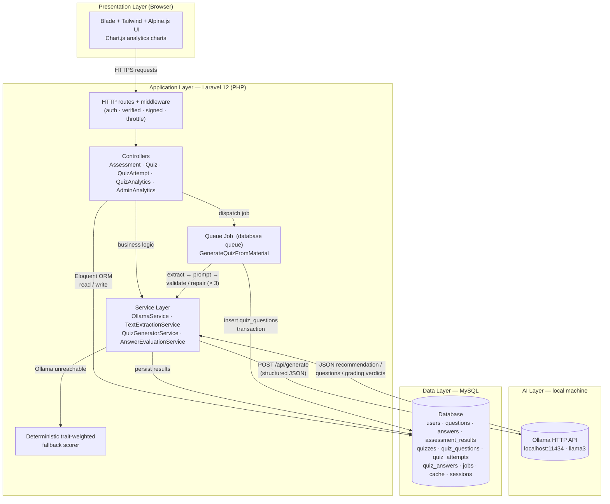

# System Architecture

**Layers:** client (browser) → Laravel application → local Ollama LLM + MySQL. The quiz
generator runs asynchronously through the database-backed queue worker; the assessment
recommendation runs synchronously with an automatic deterministic fallback.