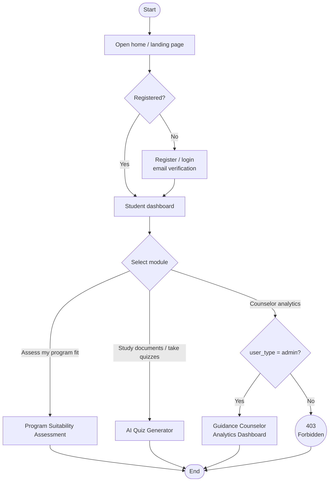

# System Flowchart

- Authenticated students may take the suitability assessment or use the AI quiz generator.
- Only accounts with `user_type = admin` (the guidance counselor) may open the analytics
  dashboard; others receive `403 Forbidden`.