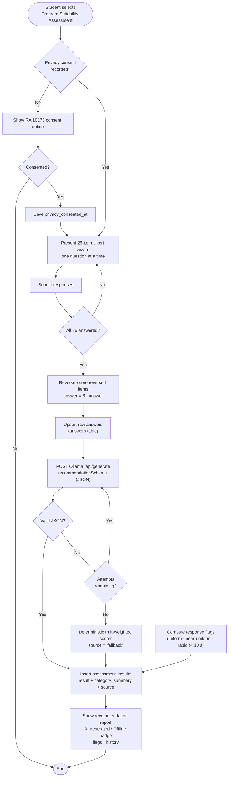

# Assessment Module Flowchart

- Consent is a one-time gate; it is recorded on the `users` table before any data is
  collected (RA 10173 Data Privacy Act).
- The AI recommendation is synchronous; if Ollama is unreachable or returns invalid JSON
  after the configured retries, the deterministic trait-weighted scorer guarantees a
  result tagged `source = fallback`, shown to the student as an "Offline estimate".