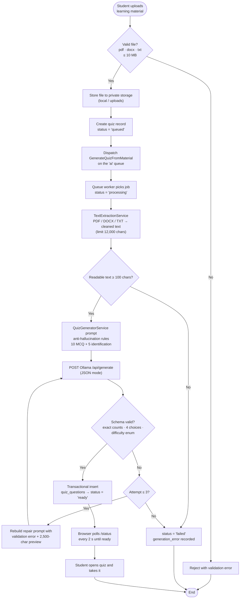

# AI Quiz Generator Flowchart

- The upload endpoint responds immediately; generation runs asynchronously on the queue
  worker so the UI is not blocked.
- Generated questions are validated against a strict JSON contract and repaired/regenerated
  up to three times before the quiz is marked `ready`.