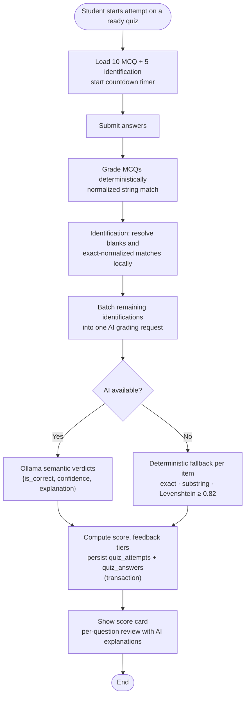

# Quiz Attempt and Grading Flowchart

- MCQs are graded with deterministic string normalization (no AI call per MCQ).
- Identification answers are graded in **one batched AI request**; blanks and exact
  matches are settled locally first, so a typical submission requires only 0–1 AI calls.
- If batch grading fails, each item falls back to exact / substring / Levenshtein
  similarity matching so a score is always produced.