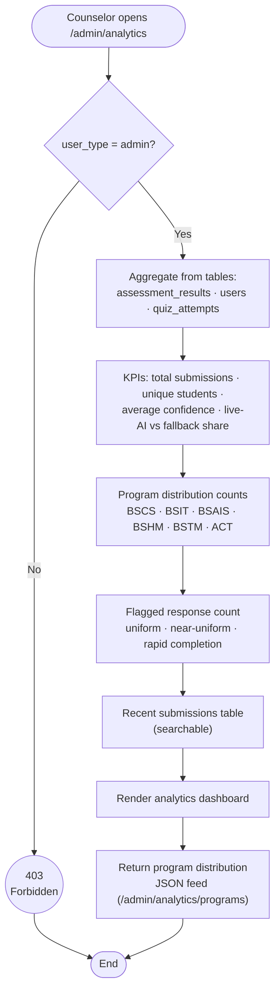

# Admin Analytics Flowchart (Guidance Counselor)

- Read-only access: the counselor views aggregates and per-program breakdowns; no
  individual student records are exposed beyond the summary table.
- The distribution feed powers the front end charts as JSON.