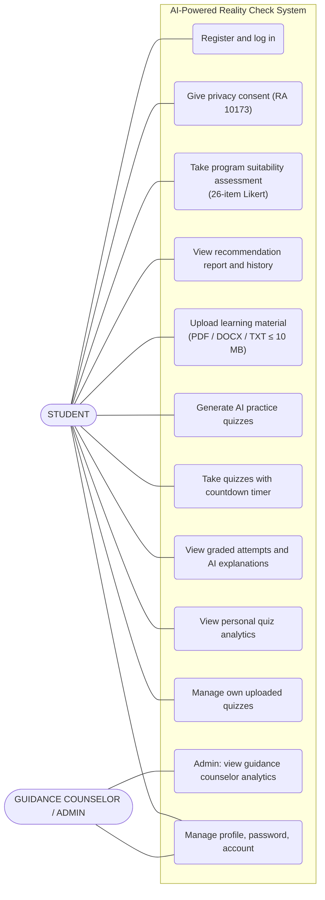

# Use Case Diagram

**Actors:** the *Student* (senior high school, incoming, or freshman college enrollee)
performs the assessment and quiz flows; the *Guidance Counselor / Admin* additionally
accesses the aggregate analytics dashboard (use case 11).