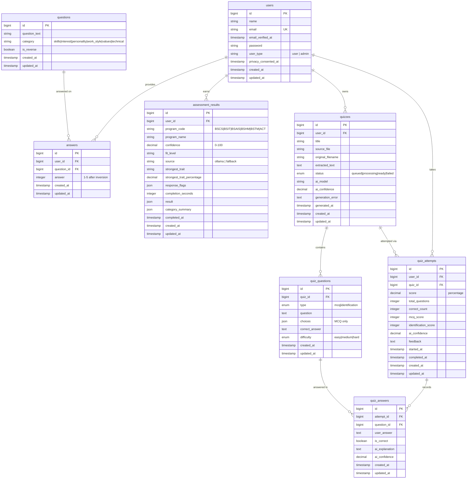

# Entity Relationship Diagram (ERD)

- **Assessment domain:** `users → answers → questions` (raw 1–5 Likert responses, reverse
  scored), and `users → assessment_results` (one row per submission = history).
- **Quiz domain:** `quizzes → quiz_questions`, `quizzes → quiz_attempts`, and
  `quiz_answers` join attempts to questions with per-answer AI explanations.
- Supporting Laravel tables (`password_reset_tokens`, `sessions`, `jobs`, `cache`, etc.)
  also exist but are framework infrastructure rather than domain data.