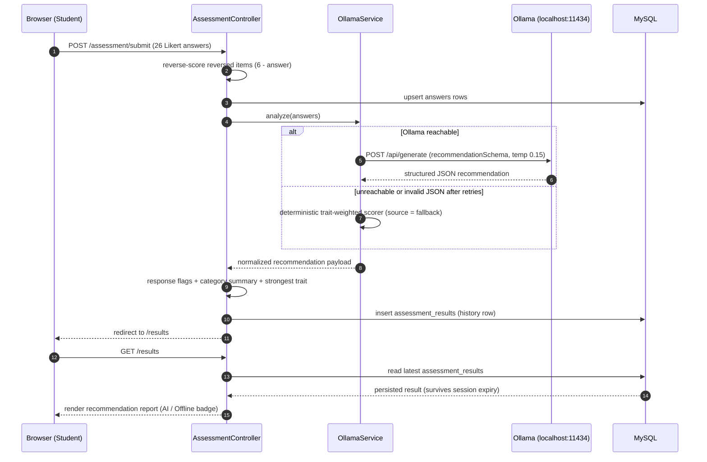

# Sequence Diagram — Assessment Submission

**Key behaviors:** reverse scoring happens before persistence; the AI result is
*persisted*, so a later session reload reads the record from the database rather than from
the session; validity flags (uniform / near-uniform / < 10 s completion) are computed
server side and attached to the saved record.