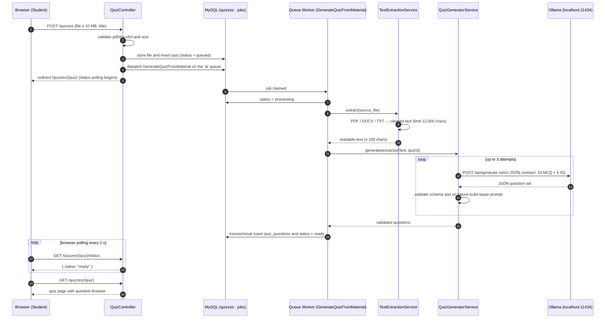

# Sequence Diagram — AI Quiz Generation

**Key behaviors:** the upload endpoint returns immediately and all heavy work runs on the
queue worker; validity is guaranteed by a strict JSON schema with a self-repairing prompt
loop (max 3 attempts); a raw generation result may be cached for 7 days to speed up repeat
generations.