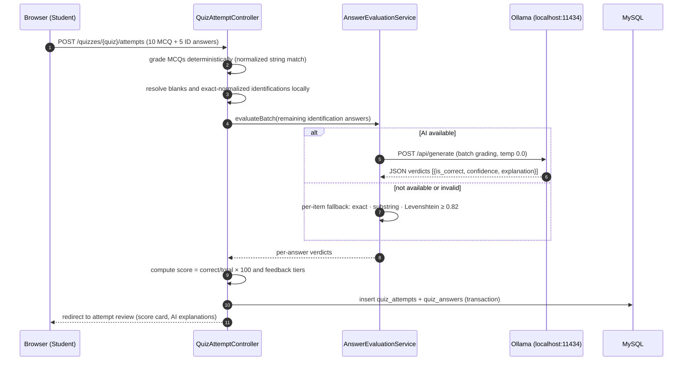

# Sequence Diagram — Quiz Attempt and Grading

**Key behaviors:** MCQs never call the AI; identification grading is batched into a single
request so a typical attempt incurs 0–1 AI calls; grading happens inside a transaction so
the attempt and its per-answer rows are stored atomically.