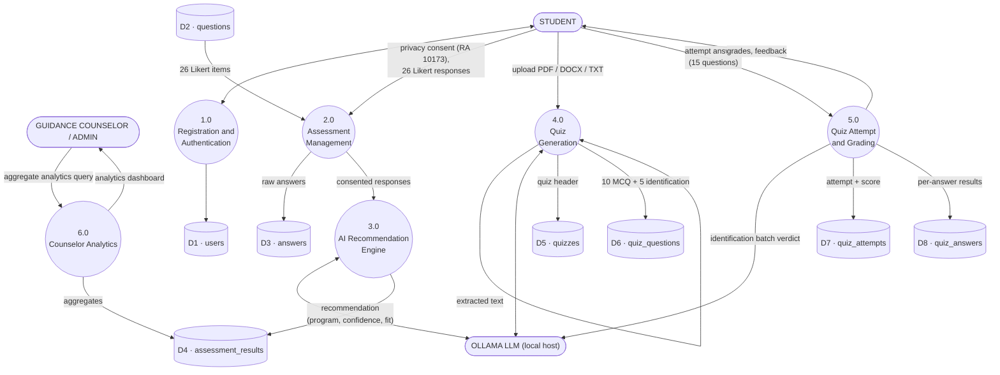

# Data Flow Diagram — Level 1

**Processes:** (1.0) authentication, (2.0) assessment capture with reverse scoring,
(3.0) AI recommendation with deterministic fallback, (4.0) quiz generation via the queue
worker, (5.0) attempt grading, (6.0) counselor assessment analytics. The counselor is an
admin `user_type` who reads aggregate assessment reports; students review their quiz results
on each completed attempt.