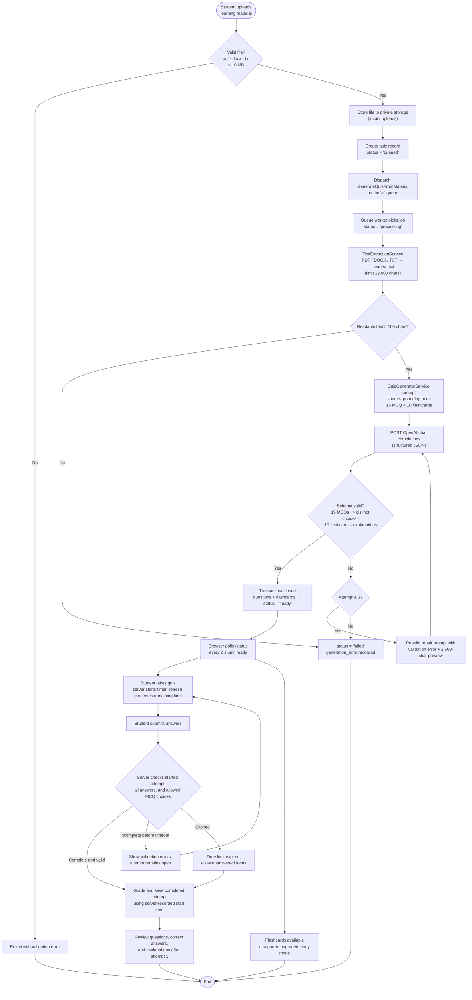

# AI Quiz Generator Flowchart

- The upload endpoint responds immediately; generation runs asynchronously on the queue
  worker so the UI is not blocked.
- Generated questions and flashcards are validated against a strict JSON contract and
  repaired/regenerated up to three times before the quiz is marked `ready`.
- Students must complete an attempt before generated questions, answer keys, and explanations are
  available for review.
- The server enforces the attempt start time, duration, answer completeness before timeout, and
  that MCQ responses match the generated choices. After the server-measured time expires, unanswered
  items may be submitted and are scored as unanswered.
- Answer keys and explanations are revealed after the first completed attempt.